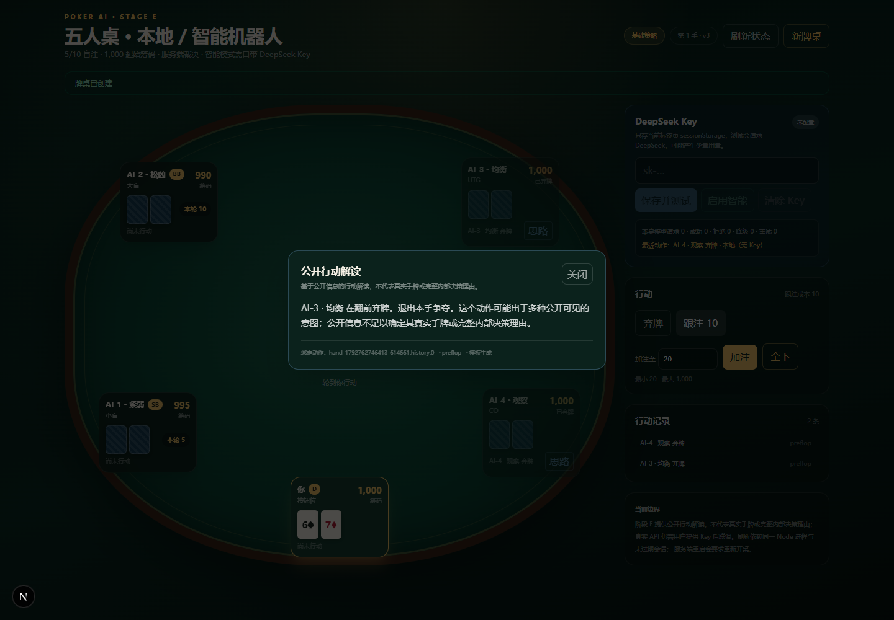

# Poker AI V3.2 · 本地德州扑克与 AI 五人桌

## 中文简介

**Poker AI V3.2** 是一个可以在自己电脑上运行的五人桌无限注**德州扑克与 AI**实验项目。它把服务端裁决的牌桌、四名不同牌风的机器人、DeepSeek BYOK 决策、并发控制和公开行动解读放在同一个可运行项目里，适合想研究 **AI 德州扑克**、**本地德州扑克**或**德州扑克与 AI 工程实践**的开发者、学习者和扑克爱好者。

如果你在搜索 **本地德州扑克**、**单机德州扑克**、**德州扑克 AI**、**AI 德州扑克**、**DeepSeek 德州扑克**、**浏览器德州扑克**或“德州扑克与 AI 怎么结合”，这个仓库覆盖了从规则、机器人、模型校验到浏览器验收的完整本地链路。

- **无需 Key 可玩**：默认由四名本地策略机器人行动，不依赖云端账号。
- **自带 DeepSeek Key**：填入自己的 Key 后可启用智能决策；Key 只存在当前标签页 `sessionStorage`，按请求转发。
- **四牌风机器人**：紧弱、松凶、均衡、观察适应，各自拥有独立决策视图。
- **不是“只写一段解释”**：模型建议需要通过 JSON、金额、合法动作校验，实际提交动作后才标记来源；失败会本地降级。
- **公开行动解读**：机器人已提交动作后可点“思路”，只读取动作发生时的公开快照，不读取底牌或私有摘要。
- **可验证的工程边界**：服务端权威状态、匿名 HttpOnly Cookie、PendingDecision、`aiEpoch`、幂等、超时与有限重试、请求/usage 统计。

> **当前是本地验收版本，不是已上线的线上产品。** 真实 DeepSeek API 尚未联调验证，没有真实请求和 usage 数据；不能把离线测试当成已连通。公开部署和真实小额联调是单独操作。

更多中文介绍、GitHub About/Topics 文案和检索词说明见 [docs/project-description.md](docs/project-description.md)。



## English Overview

Server-authoritative five-seat no-limit Texas Hold'em. The repository implements Stage A rule contracts, the Stage B playable table, Stage C BYOK/mode/pending control, the Stage D four-bot model-decision pipeline, and Stage E public action insight plus delivery checks. Stage D is verified offline; a real DeepSeek call has not been made without a user Key and budget authorization.

## Requirements

- Node.js `>=24.15.0` (the rule engine requires it)
- pnpm `11.7.0` (declared in `package.json`)
- A browser for the table; Playwright tests use the installed Chrome channel

The current runtime must use Node 24.21.0 or another version satisfying the engine range. A PATH Node 21 is not sufficient.

## Start / 启动

中文运行提示：安装依赖后执行 `pnpm dev`，打开 `http://127.0.0.1:3000`。默认本地模式，不需要 DeepSeek Key。

```bash
pnpm install --frozen-lockfile
pnpm dev
# http://127.0.0.1:3000
```

The app starts with four bots. A DeepSeek Key is optional; if supplied it is kept in the current tab's `sessionStorage` and sent only as a per-request header for `/api/ai/test` and `/api/ai/decision`. In smart mode each bot receives its own style, own cards, public table/action history and legal-action window; thinking is explicitly disabled, output is capped at 800 tokens, and the node deadline is 12 seconds with at most one retry.

A browser refresh restores the game only while the same Node process still holds the in-memory session (30-minute idle TTL). A process restart returns `SESSION_NOT_FOUND` and the UI asks for a new table.

## Commands

```bash
pnpm test
pnpm test:rules
pnpm test:contracts
pnpm typecheck
pnpm lint
pnpm format:check
pnpm build
pnpm test:browser   # requires the dev server at 127.0.0.1:3000
```

`pnpm test:browser` skips the deterministic rebuy scenario unless the test server is started with `POKER_STAGE_B_TEST_TABLE=1` and `POKER_TEST_REBUY=1` is set for the Playwright process. This fixture is development/test-only; production uses the secure random table factory.

## Current scope

- Five fixed seats, 5/10 blinds, 1,000 starting chips.
- Human actions and local bot turn-by-turn progression.
- Settlement, action log, next hand, bot auto top-up, human rebuy.
- Anonymous HttpOnly cookie ownership; single-process in-memory sessions.
- Key test/clear/rotate, `aiEpoch`, PendingDecision, duplicate-turn and stale-epoch control.
- Four bot styles, private-safe decision DTO, JSON/legal/amount validation, local fallback, source tags and token/usage stats.
- A01/A02/V01 are covered by controlled model doubles; Stage C in-flight/isolation tests are retained.
- Public “思路” insight is a server template bound to a submitted actionEventId; it uses only an action-time public snapshot and never calls a model.
- Stage E browser checks cover insight, mobile bet controls, refresh/new-tab sessionStorage, and expired-session messaging.
- **Real DeepSeek API remains unverified** until the user supplies a Key and an explicit small request budget.
- No account, database, or real-player multiplayer.

## Deployment

Local production-style start:

```bash
pnpm build
pnpm start -- -H 127.0.0.1 -p 3000
```

The app must run as **one Node process/one instance**. Sessions are in-memory and disappear on restart. See [docs/deployment.md](docs/deployment.md) for Key/cost, proxy, security and limitation notes. Public deployment is not part of this local delivery.

## API surface

```text
POST /api/game/start
GET  /api/game/state
POST /api/game/action
POST /api/game/next
POST /api/ai/test
POST /api/ai/mode
POST /api/ai/decision
GET  /api/ai/insight
```

The DeepSeek destination is fixed to `https://api.deepseek.com`; the Key is never stored in the game session, URL, body, or cache.

See:

- `docs/specs/poker-ai-v3.2.md`
- `docs/specs/deepseek-development-handoff.md`
- `docs/plans/implementation-plan.md`
- `docs/plans/rule-engine-assessment.md`
- `docs/plans/stage-b-report.md`
- `docs/plans/stage-c-report.md`
- `docs/plans/stage-d-report.md`
- `docs/plans/stage-e-report.md`
- `docs/acceptance-matrix.md`
- `docs/deployment.md`
- `docs/project-description.md`（中文项目描述、GitHub About/Topics 与检索说明）
- `docs/progress.md`
